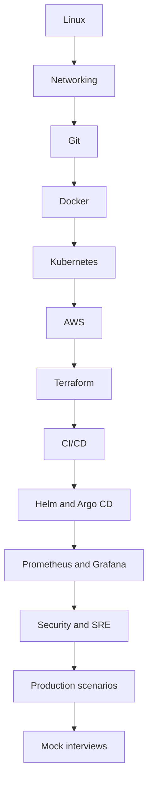

# Learning path

## Competency levels
| Level | Expected capability |
|---|---|
| Beginner | Explain concepts, use commands, deploy a basic app |
| Intermediate | Build pipelines, provision cloud resources and debug failures |
| Advanced | Design resilient platforms, secure workloads and lead incident response |

## Study loop
1. Learn the mental model.
2. Draw the architecture from memory.
3. Complete a hands-on lab.
4. Answer basic, intermediate, advanced and scenario questions.
5. Explain the topic aloud in 2–3 minutes.
6. Record gaps in `progress/weak-areas.md`.

For a 2–5 year role, prioritize Linux, networking, Docker, Kubernetes, AWS, Terraform and CI/CD. Differentiate yourself with incident response, observability, security and system design.
