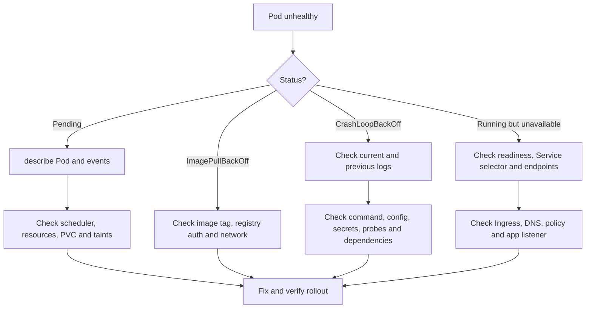
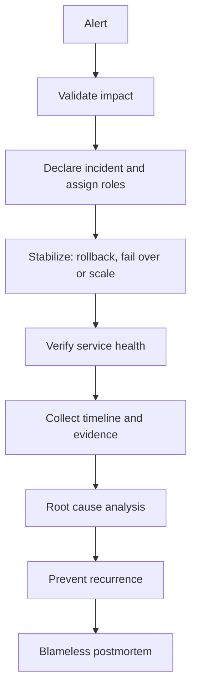

# Production scenarios and troubleshooting

## Kubernetes Pod failure

## Incident response

## Scenario checklist
- **Service has no endpoints:** compare Service selector with Pod labels, readiness and EndpointSlices.
- **Ingress returns 502:** inspect ingress controller, backend Service, endpoints, target port and app health.
- **Pipeline failed after dependency update:** inspect lockfile, cache, build logs, test results and dependency source.
- **Deployment caused production errors:** stop rollout, assess blast radius, rollback known-good immutable artifact, verify and communicate.
- **EKS nodes cannot join:** check IAM role, subnet routes, security groups, API endpoint reachability and bootstrap logs.

Always establish impact, stabilize safely, gather evidence, recover, validate, communicate and document prevention.
