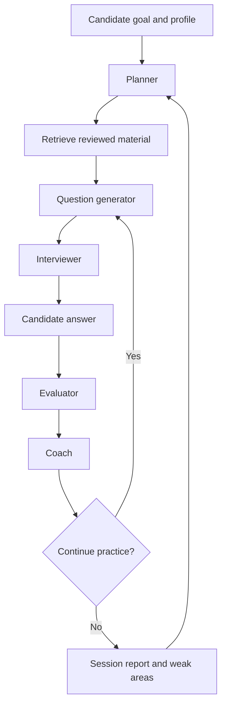

# AI agents and workflows

| Agent | Responsibility | Output | Guardrail |
|---|---|---|---|
| Planner | Turn target role, level, time and gaps into a plan | Milestones and labs | Realistic schedule; state assumptions |
| Question generator | Create topic/level-specific question | Question, rubric, follow-up | Avoid ambiguity and duplicates |
| Interviewer | Ask one question at a time | Next question | Do not reveal answer before response |
| Evaluator | Assess answer against rubric | Score, evidence, gaps | Score only evidence provided |
| Coach | Identify repeated weaknesses | Prioritized practice plan | Specific, respectful feedback |
| Scenario simulator | Simulate incident interview | Incident prompt and clues | No real infrastructure actions |
| Retrieval agent | Find relevant reviewed content | Source-backed snippets | Distinguish source facts from inference |

## Implementation approach
Start with one orchestrator and bounded Python functions. Add separate model calls only when a task needs different context or evaluation. Each agent accepts validated input and returns validated output.

## Reliability and safety
- Timeouts, bounded retries, per-session token/cost budgets.
- Log prompt/model version and schema validation status.
- Redact secrets and personal data.
- Human review before publishing question-bank content.
- No shell, cloud-console or production permissions for agents.
