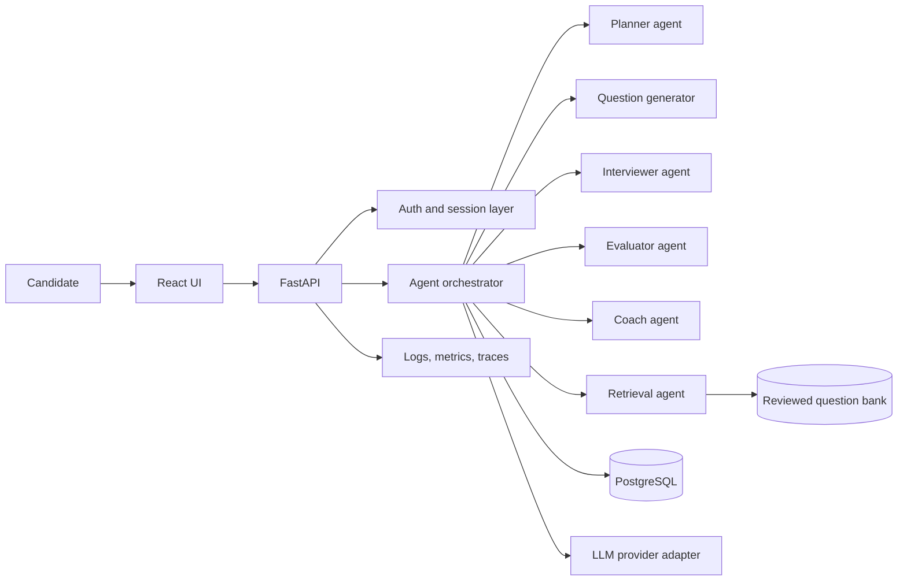
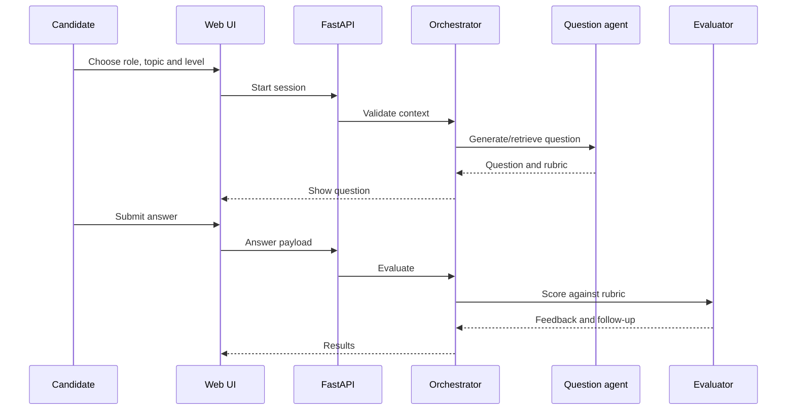

# AI platform architecture

## Interview sequence

Keep the orchestrator in control. Validate structured outputs. Retrieve reviewed material before generating. Persist evidence and scores. Never expose provider keys in the frontend.
